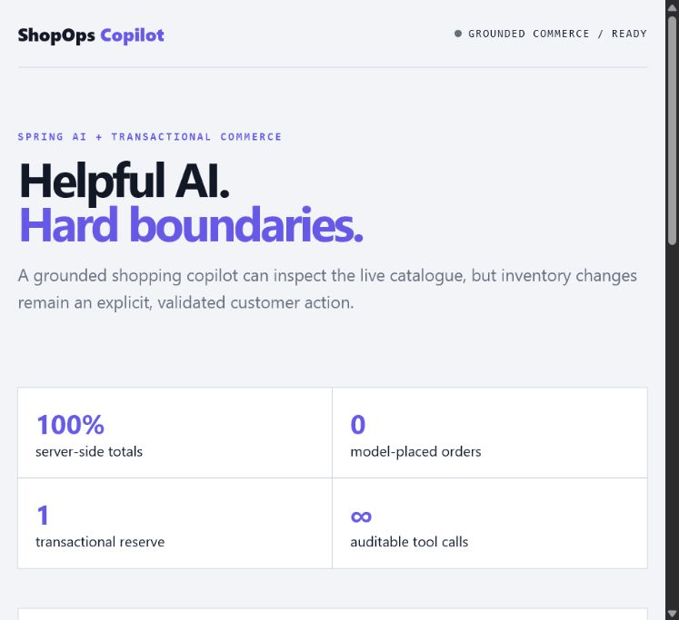

# ShopOps Copilot

An original, production-oriented e-commerce backend built with Spring Boot and Spring AI. It combines a transactional catalog/order core with a grounded shopping copilot that must query live product tools before making price or availability claims.

## Product tour



[Open the full-resolution screenshot](docs/media/product-console.jpg) · **Recruiter demo:** query the live catalogue through grounded tools, explain why the model cannot order, then reserve inventory through the explicit transactional endpoint.

> **Deployment status:** tested, containerized and ready for an AWS deployment with managed PostgreSQL and secrets; OpenAI execution requires operator-supplied credentials and no public production endpoint is claimed yet.

## Production design

- Optimistic locking prevents silent inventory races; order totals are calculated server-side.
- The model can search and inspect products but **cannot place orders**. A separate validated endpoint creates a reservation only after explicit user action.
- PostgreSQL, Flyway, API-key authentication, health probes and Prometheus metrics are included.
- AI can be disabled without fabricating answers. Production activation requires an OpenAI key.
- Containers run as a non-root user with a read-only filesystem.

## APIs

- `GET /api/products?q=hiking`
- `POST /api/assistant` — grounded, tool-using shopping guidance
- `POST /api/orders` — explicit inventory reservation

Every business endpoint requires `X-API-Key`.

```bash
cp .env.example .env
docker compose up --build
```

```bash
mvn verify
```

The product model, grounded tool architecture, approval boundary, inventory transaction design, APIs and operational packaging are original.
